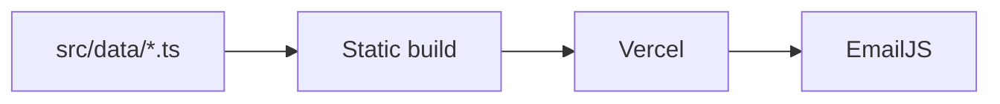

# Case study: emmanuelebri.dev

## Overview
My personal portfolio: project case studies, long form articles, my experience and resumes, with a contact form and a Calendly booking embed.

## The problem
Most portfolios look like the template they came from and reduce real work to a grid of thumbnails. I wanted pages with room to explain why I made each decision, on a site that is fast and cheap to run.

## What I built
- Case study pages generated from typed project data
- A blog with headings, pull quotes and zoomable code figures
- Light and dark themes from one set of design tokens, with no flash on load
- Downloadable resumes for full stack, frontend and backend roles
- A contact form through EmailJS and a Calendly embed

## How it works
Next.js 16 App Router with React 19 and TypeScript. All content lives in `src/data/*.ts`. Project and blog routes are listed with `generateStaticParams`, so every page is static HTML at build. Only the parts that move, like the theme toggle, filters and contact form, are client components.

## Challenges and how I solved them
- **Broken content reaching production.** Article bodies are parsed at build into a typed union, so a bad block fails the build.
- **Unreadable code images on phones.** Screenshots open in a lightbox with zoom.
- **Theme flicker.** Colours are CSS variables redefined under a `.dark` class, handled by next-themes.

## Outcome
Live on Vercel with lint and build checks in CI and automatic deploys from main. <!-- add real metric: e.g. Lighthouse score -->

## Links
- Live: www.emmanuelebri.dev
- Code: github.com/emmybest19/my-portfolio
